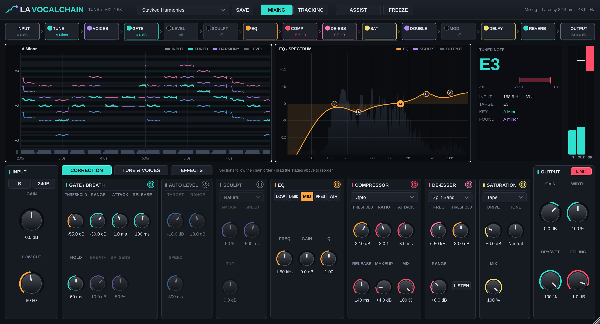
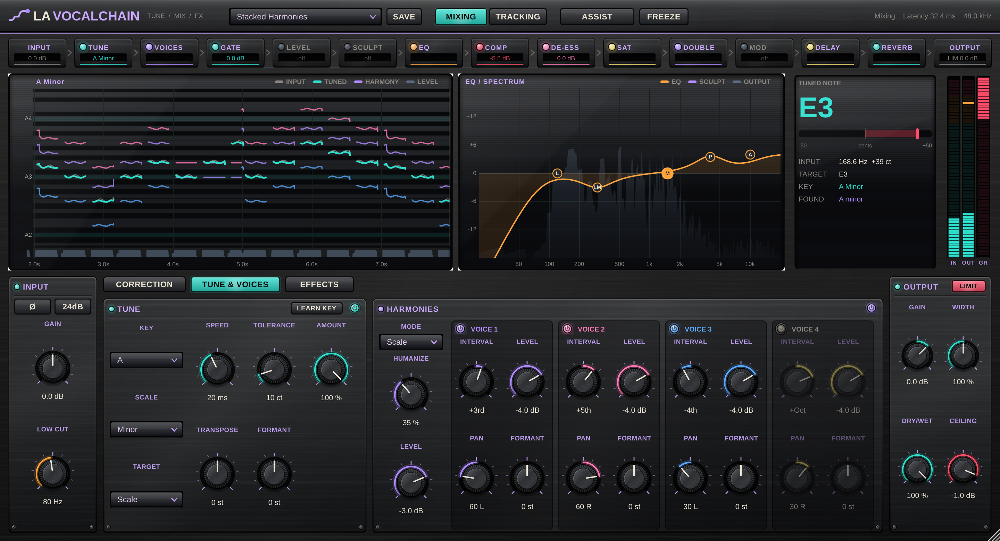
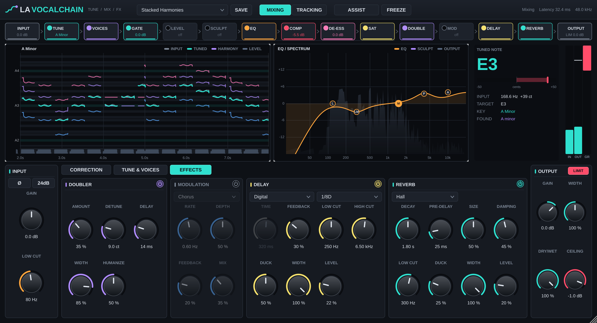

# LA-VocalChain

A complete vocal chain in one plugin for Linux, Windows and macOS (VST3, plus LV2 / Standalone on Linux and AU on macOS): pitch correction,
harmonies, gate and breath control, auto level, de-esser, adaptive tone shaping, EQ, compression,
saturation, doubler, modulation, delay, reverb and a limiter. It uses the same look as LA-Trigger.



| Tune & Voices page | Effects page |
|---|---|
|  |  |

## Signal flow

```
INPUT -> TUNE -> VOICES -> [ GATE  LEVEL  SCULPT  EQ  COMP  DE-ESS  SAT ] -> DOUBLE -> MOD -> DELAY -> REVERB -> OUTPUT
                            \______ drag to reorder in the chain strip ______/
```

Each stage is a tile in the chain strip at the top. Click a tile's dot to switch the stage on or off.
Click the tile to open its controls. Drag the correction tiles to change their order, and the
control sections below follow the same order. The order is saved with the session and in presets.

## Features

| Stage | What it does |
|---|---|
| **Input** | Gain, phase invert, low cut (12 or 24 dB/oct). |
| **Tune** | Real-time pitch correction to a key and scale (12 scales), or to notes played on the MIDI input. *Speed* goes from hard/robotic (0 ms) to natural glides. *Tolerance* leaves notes alone when they are already close, so vibrato and expression stay. Also *Amount*, *Transpose* (±12 st) and *Formant* (±12 st, changes the vocal character without changing the pitch). **LEARN KEY** detects the key from your singing. |
| **Voices (harmonies)** | Up to 4 generated harmony voices. Each voice has an interval, level, pan and formant. In *Scale* mode the intervals are scale degrees in the Tune key (a "3rd" stays diatonic). *Semitones* mode uses fixed intervals. *MIDI Chord* mode makes the voices sing the notes you hold on the MIDI input. *Humanize* adds timing and pitch drift so the stack sounds like real singers. |
| **Gate / Breath** | Downward expander with threshold, range, attack, hold and release. **Breath control** detects breaths between phrases (unvoiced, quiet compared with the phrase, not sibilant) and turns them down. It works even with the gate off. |
| **Auto Level** | A vocal rider. It rides the level towards a target before compression, within a set range and speed. |
| **Sculpt** | Adaptive tone balancing. It measures the vocal in 8 bands and continuously steers it towards a target style (Natural, Modern Pop, Warm, Upfront, Rock, Airy, Intimate, Radio, Smooth). Controls are *Amount*, *Speed* and *Tilt*. The current correction curve is drawn on the EQ display. |
| **EQ** | 5 bands: low shelf, three bells and an air shelf. Drag the nodes on the EQ display, use the mouse wheel to change Q or slope, and double-click to reset a band. A real-time output spectrum is shown behind the curve. |
| **Compressor** | Five characters: *Clean* (VCA), *Opto* (program-dependent release), *FET* (fast, adds grit), *Tube* (vari-mu, ratio grows with level) and *Multiband* (3 bands). Controls are threshold, ratio, attack, release, makeup and parallel mix. |
| **De-Esser** | Split-band (Linkwitz-Riley, so only the "s" band moves) or wide-band. Frequency, threshold, range and **LISTEN**. |
| **Saturation** | Tape, Tube, Console, Exciter or Radio. Drive, tone and mix, with 2x oversampling. |
| **Doubler** | ADT-style double tracking: two detuned, delayed, drifting copies spread left and right. |
| **Modulation** | Chorus, flanger or phaser. |
| **Delay** | Digital, Tape (wow/flutter, saturated repeats), Ping-Pong or Slapback. Free time or tempo sync (1/32 to 1 bar, dotted, triplet). Low/high cut in the feedback, **ducking** while the vocal sings, and width. |
| **Reverb** | Plate, Room, Hall or Chamber (8-line feedback delay network with early reflections). Decay, pre-delay, size, damping, low cut, ducking, width and level. |
| **Output** | Gain, stereo width (0–200 %), global dry/wet, and a look-ahead **limiter** with a ceiling. |
| **Assist** | Press **ASSIST**, sing 10–20 seconds, then press it again. It sets input gain, gate threshold, de-esser threshold, low cut (from your lowest notes), compressor and auto-level, switches on Sculpt, and detects the key. |
| **Modes** | **Mixing**: best pitch quality, about 32 ms latency (compensated by the DAW). **Tracking**: about 4 ms latency for monitoring while recording. |
| **Displays** | Scrolling piano-roll of the sung pitch, tuned pitch and harmony voices over the scale. EQ, Sculpt curve and spectrum. A big note read-out with a cents meter. IN/OUT/GR meters. Each chain tile shows its live gain reduction. |
| **Presets** | 14 factory presets: Modern Pop Lead, Hip-Hop Upfront, Hard Tune (Trap), R&B Silk, Rock Grit, Indie Intimate, Podcast / Voice-Over, Stacked Harmonies, Wide Double, Lo-Fi Radio, Ballad Hall, Robot Formant, Live Tracking. **SAVE** stores user presets in `~/.config/LA Audio/LA-VocalChain/Presets`. |

### Compared with other all-in-one vocal chains

The feature set was checked against Neural DSP Mantra, iZotope Nectar 4 and the Waves vocal plugins
(CLA Vocals, Vocal Rider, Renaissance Vox, Sibilance):

| Feature | Covered by |
|---|---|
| Pitch correction with speed, tolerance, formant, pitch shift (Mantra *Tune*, Nectar *Pitch*) | Tune |
| Up to 8 harmony voices / MIDI-driven harmonies (Mantra *Harmonies*, Nectar *Voices* / *Backer*) | Voices (4 voices; Scale, Semitone and MIDI Chord modes) |
| Gate (Mantra, Nectar, R-Vox) | Gate |
| Breath control (Nectar) | Gate / Breath |
| Automatic level riding (Waves Vocal Rider, Nectar *Auto-Level*) | Auto Level |
| Automatic EQ / spectral shaping with target styles and tilt (Mantra *Sculpt*) | Sculpt |
| EQ | EQ (draggable) |
| Compressor characters incl. multiband (Mantra Tube / Stress / Multi, Nectar dual comp) | Compressor (5 characters) |
| De-esser (Mantra, Nectar, Waves Sibilance) | De-Esser |
| Saturation / exciter | Saturation |
| Doubler (Mantra) / Dimension (Nectar chorus, flanger, phaser) | Doubler, Modulation |
| Delay and reverb with ducking (Mantra Post FX, CLA Vocals) | Delay, Reverb |
| Tracking vs Mixing mode (Mantra) | MIXING / TRACKING |
| Vocal Assistant and key detection (Nectar) | ASSIST, LEARN KEY |
| Module re-ordering (missing in Mantra) | Drag the chain tiles |
| User presets saved per module (missing in Mantra) | SAVE (whole chain + order) |

Not included: Nectar's *Unmask* (it needs the backing track on a sidechain) and AI or
reference-track matching.

### Latency

Pitch correction needs about two pitch periods of audio before it can resynthesize, so Mixing mode
reports about 32 ms (1555 samples at 48 kHz). Tracking mode reports about 4 ms. In Tracking mode,
low voices are monitored a few ms later than reported. The plugin reports its latency to the DAW, so
keep plugin delay compensation enabled. When Tune is off, stereo sources keep their stereo image.

## Building

### Linux

```bash
sudo apt install build-essential cmake ninja-build libasound2-dev libx11-dev libxrandr-dev \
  libxinerama-dev libxcursor-dev libxext-dev libfreetype-dev libfontconfig1-dev libgl1-mesa-dev

cmake -B build -G Ninja -DCMAKE_BUILD_TYPE=Release        # downloads JUCE 8 automatically
cmake --build build -j
xvfb-run -a ctest --test-dir build --output-on-failure    # optional: run the tests

# install
mkdir -p ~/.vst3 ~/.lv2
cp -r build/LAVocalChain_artefacts/Release/VST3/LA-VocalChain.vst3 ~/.vst3/
cp -r build/LAVocalChain_artefacts/Release/LV2/LA-VocalChain.lv2 ~/.lv2/
```

Options:
- `-DLAVC_JUCE_DIR=/path/to/JUCE` uses a local JUCE checkout.
- `-DLAVC_COPY_AFTER_BUILD=ON` installs the plugins automatically.

### Windows

Needs Visual Studio 2022 (the "Desktop development with C++" workload) and CMake 3.22 or newer.

```powershell
cmake -B build -G "Visual Studio 17 2022" -A x64          # downloads JUCE 8 automatically
cmake --build build --config Release --parallel
ctest --test-dir build -C Release --output-on-failure       # optional: run the tests
```

Install by copying `build\LAVocalChain_artefacts\Release\VST3\LA-VocalChain.vst3` into `C:\Program Files\Common Files\VST3`.

### macOS

Needs Xcode (or the Command Line Tools) and CMake 3.22 or newer. The build is a universal binary
(Apple silicon and Intel) and runs on macOS 10.13 or newer.

```bash
cmake -B build -DCMAKE_BUILD_TYPE=Release                   # downloads JUCE 8 automatically
cmake --build build --parallel
ctest --test-dir build --output-on-failure                  # optional: run the tests

# install
cp -R build/LAVocalChain_artefacts/Release/VST3/LA-VocalChain.vst3 ~/Library/Audio/Plug-Ins/VST3/
cp -R build/LAVocalChain_artefacts/Release/AU/LA-VocalChain.component ~/Library/Audio/Plug-Ins/Components/
```

### Downloads

GitHub Actions builds every push on Linux, Windows and macOS and uploads ready-to-install archives as
artifacts. Tagged releases carry all three:

- `LA-VocalChain-linux-x86_64.tar.gz`: VST3, LV2 and Standalone. Copy them into `~/.vst3` and `~/.lv2`.
- `LA-VocalChain-windows-x64.zip`: VST3. Extract it into `C:\Program Files\Common Files\VST3`.
- `LA-VocalChain-macos-universal.zip`: VST3 and AU. Copy them into `~/Library/Audio/Plug-Ins/VST3` and
  `~/Library/Audio/Plug-Ins/Components`. The plugins are not notarized, so after downloading, clear the
  quarantine flag once before starting your DAW:
  `xattr -dr com.apple.quarantine ~/Library/Audio/Plug-Ins/VST3/LA-VocalChain.vst3 ~/Library/Audio/Plug-Ins/Components/LA-VocalChain.component`

### Using MIDI

To tune to MIDI notes (Tune → Target: *MIDI Notes*) or to sing MIDI chords (Voices → Mode:
*MIDI Chord*), route a MIDI track or keyboard to LA-VocalChain's MIDI input. In Reaper, add a send
from a MIDI track with *MIDI: All*. In Bitwig, use a Note Receiver. In Ardour, connect the plugin's
MIDI input in the routing grid.

## Project layout

```
Source/dsp/PitchEngine.*   YIN pitch detection, TD-PSOLA tuning/harmonies/formants, key detection
Source/dsp/Modules.*       gate + breath, auto level, de-esser, sculpt, EQ, compressor, saturation, limiter
Source/dsp/Effects.*       doubler, chorus/flanger/phaser, delay, FDN reverb
Source/dsp/VocalEngine.*   the chain, module order, latency, meters, Assistant statistics (no JUCE dependency)
Source/Parameters.*        127 parameters and the factory presets
Source/PluginProcessor.*   JUCE processor: buses, MIDI, mode switching, Assistant, key learning, presets, state
Source/gui/                look and feel, knobs, chain strip, pitch / EQ displays, editor
tests/EngineTests.cpp      29 DSP tests on synthetic voices (pitch accuracy, tuning, harmonies, key, dynamics, latency...)
tests/PluginIntegrationTest  drives processor + editor like a host; can render a screenshot
```

## License note

LA-VocalChain is built on [JUCE 8](https://juce.com), which is dual-licensed under AGPLv3 or a
commercial license. Distributing builds requires either releasing this code under AGPLv3 or
holding a JUCE commercial license.
